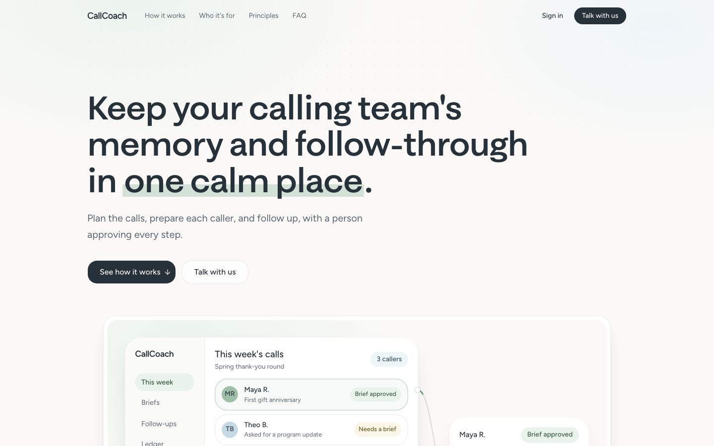
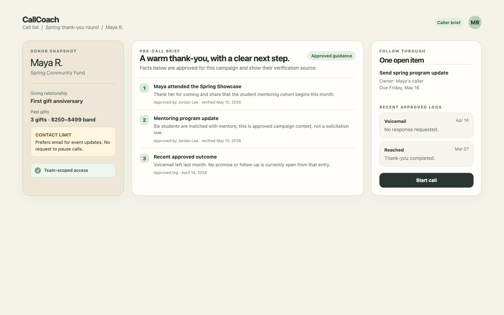
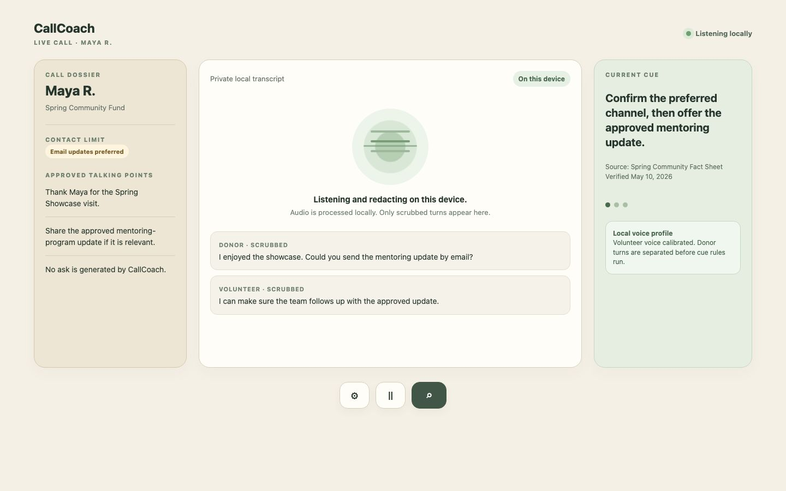
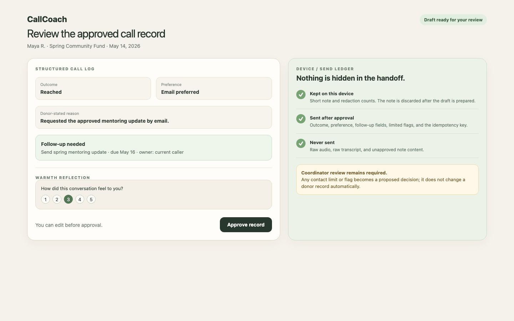
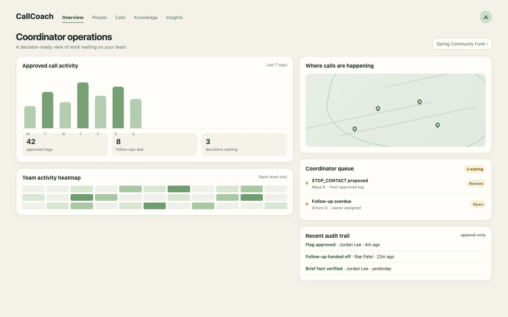
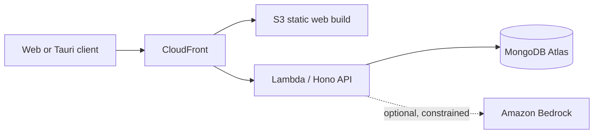

# CallCoach

**Call capture and follow-through for volunteer fundraising teams.**

CallCoach gives coordinators and volunteer callers a shared, privacy-minded way to prepare for a donor conversation, approve what becomes a record, and make sure the next action has an owner. It is built for teams where callers and leadership rotate, but donor context should not disappear with them.

> **Nothing leaves a volunteer's device until that volunteer approves a structured record.** The ledger shows what was retained locally and what was sent. Coordinators review every flag, follow-up, and contact-limit decision.

## Demo video

[Watch the 90-second demo (MP4)](docs/video/callcoach-pitch-final.mp4). It uses screen recordings and stills from the local app with synthetic data only. The live-call segment is a labelled simulation with a synthetic donor.

## Product views

| Public landing | Pre-call brief |
| --- | --- |
|  |  |

| Local AI call surface | Post-call approval ledger |
| --- | --- |
|  |  |

| Coordinator operations |
| --- |
|  |

*The landing image is captured from the local app. The remaining product-view mockups reflect implemented flows and use synthetic demonstration data only.*

## Security is the product boundary

CallCoach is deliberately **not** a transcript recorder. The useful record begins only after a caller can see, edit, and approve a small structured summary.

- **Device boundary:** raw audio, raw recognized text, and the caller's free-form note stay in device memory. The audio and raw text are released after the local processing pass; they have no API route or database field.
- **Redaction boundary:** known donor identifiers, pattern matches, phrase rules, and local NER run before a turn is displayed or used to construct a draft. If local NER fails, the flow holds the segment by default.
- **Approval boundary:** the strict approved payload is the only post-call object sent to the server. The ledger is rendered from that exact object, so callers can inspect the handoff before it occurs.
- **Model boundary:** a model may receive a scrubbed note only for constrained draft text, or approved structured log fields for an optional warmth crosscheck. It never receives raw audio or a raw transcript, and it cannot make a donor-record change.
- **Decision boundary:** flags, contact limits, and follow-ups are proposals until a person decides. Audit records make those decisions traceable.

## The problem

Volunteer calling programs depend on relationships, memory, and follow-through. Those are fragile when coordinators change, callers work short shifts, and information lives in personal notes or a few people's heads. Teams lose track of who was contacted, what was promised, and which next step is still open.

A small-nonprofit coordinator we interviewed described the work **before and after** a call as the bigger gap: people need enough context to understand a donor, and the organization needs a reliable way to carry the outcome forward. A 3Dots stakeholder described little existing call infrastructure and saw value in clearer visibility into both who to call and how to approach the call. A coordinator we interviewed also described a distributed student fundraising program where callers reach international donors from a U.S. headquarters across time zones; that is interview context, not a claim about that organization's own data.

CallCoach is designed for the recurring shape of this problem:

- **Student calling teams and THON-style committees** with annual leadership turnover and many volunteers.
- **Fraternities and sororities** with rotating officers and alumni call lists.
- **Churches, congregations, and community groups** where volunteers make outreach possible while staff capacity changes.
- **Small nonprofits** that need continuity without adding a heavyweight CRM workflow to every conversation.

## What the product does

```mermaid
flowchart LR
    A[Coordinator plans a call list] --> B[Caller opens a sourced donor brief]
    B --> C[Caller records a short local note]
    C --> D[Device-side redaction and structured draft]
    D --> E[Caller approves only the structured log]
    E --> F[Coordinator reviews flags and pending limits]
    F --> G[Owned follow-up, handoff, or closure]
    G --> H[Durable activity and audit trail]
```



### Before a call: useful context, not a data dump

- A donor brief combines the donor snapshot, stated contact limits, open follow-ups, recent approved logs, campaign-specific approved facts, and deterministic talking points.
- Fact-sheet content is scoped to the donor's campaign, includes a source and verification date, and is marked stale when it exceeds the configured age.
- Callers only see donors assigned to their team. Coordinators can work across their teams and subteams.

### During and after a call: call capture with a consent gate

- The local flow can transcribe audio with bundled models, identify the volunteer's voice after calibration, and redact known identifiers, pattern matches, phrases, and local NER results before a turn is shown.
- Raw audio, raw transcript text, and the free-form note remain in device memory. They are not database fields, API payloads, or model inputs outside the narrow scrubbed-note draft path.
- Deterministic rules create a fixed, editable draft: outcome, stated reason, preference, follow-up, and limited review flags.
- The caller approves a strict structured payload. The browser ledger is generated from that same object, so the caller can see exactly what is sent.

### Follow-through: every item has a decision-maker

- Follow-ups have an owner, due date, and lifecycle: open, done, handed off, or cancelled. Overdue is calculated in the team's time zone.
- Flags enter a coordinator queue as suggestions. A coordinator can approve, override with a note, or resolve them.
- `stop_calls` and `STOP_CONTACT` create a **pending** limit. The donor record changes only after coordinator approval.
- Every approval and decision writes an append-only audit record. Approved logs are never edited; corrections are new entries that reference the prior record.

### Coaching without a leaderboard

- A caller can record a 1–5 warmth reflection using shared anchors.
- An optional model crosscheck receives only approved log fields, never a raw note or transcript.
- The caller and coordinator can see the two scores and the gap, but CallCoach never averages them, ranks callers, or exposes team-wide individual scoreboards.

## Why this fits the market

CallCoach sits beside a CRM rather than asking volunteer teams to replace one. It makes the handoff between a human conversation and the organization's system of record more dependable:

| Need | CallCoach response |
| --- | --- |
| **Continuity** | Approved briefs, outcomes, handoffs, and open follow-ups remain available when people rotate out. |
| **Proactive operations** | A call list includes context, follow-ups have owners and dates, and queues show decisions waiting for a coordinator. |
| **Customization** | Campaign facts, approved knowledge, rubrics, and cue rules reflect each organization's priorities. |
| **Safe call capture** | The caller controls approval; the system stores structured records, never a transcript or raw note. |
| **CRM compatibility** | The record shape is designed to export approved activity back to CRM notes rather than duplicate an entire CRM. |

The distinctive choice is that useful automation is bounded by a human decision at every consequential step. That makes the product workable for small teams that need help maintaining a living operational memory, while keeping donor communication and donor-record changes in human hands.

## Track alignment

### Transpose — data for the real world

CallCoach turns operational data into decisions instead of dashboards for their own sake:

- A coordinator can see **who to call and why** in a call list.
- An overdue follow-up has an **owner** and a concrete completion or handoff action.
- A flag or pending contact limit sits in a queue until a coordinator makes a decision.
- A new coordinator can work from briefs, open work, and audit history rather than reconstructing the program from scattered notes.

This is a natural fit for a track focused on making data actionable. The exact sponsor RFS language was not available in the project materials, so this section intentionally maps to the supplied “data for the real world” goal without claiming a wording match.

### Y Combinator Request for Startups — AI-Native Compliance Infrastructure

CallCoach treats compliance as part of the workflow rather than a report produced afterwards:

- **Consent gate before data moves:** raw audio and transcript text stay on the caller's device. Only a strict, caller-approved structured payload is sent, and the ledger shows exactly that payload.
- **Identifier guard before any model call:** the server rejects identifiers before Bedrock sees anything, and errors report counts and types only, never the offending text.
- **Human decisions on record:** flags, contact limits, and follow-ups stay proposals until a coordinator decides. Every approval and decision writes an append-only audit record.
- **Contact preferences enforced:** a stop-contact request creates a pending limit that a coordinator must approve before the donor record changes.
- **Bounded AI:** model output is parsed with Zod, restricted to allowed labels, and shown as unavailable when invalid. The model never contacts a donor or edits a record.

This section maps CallCoach to the theme of the RFS; it does not claim any affiliation with Y Combinator.

### AWS

The deployed architecture is intentionally small and production-shaped:



- **CloudFront + S3:** serve the Vite application over HTTPS. CloudFront keeps the S3 bucket private through Origin Access Control and rewrites SPA routes safely.
- **Lambda:** hosts the Hono API behind the CloudFront `/api/*` path. The same application runs locally for development.
- **Bedrock:** supports narrow, human-reviewed post-call enrichment: a scrubbed note can fill constrained draft fields, and approved structured log fields can produce the optional warmth crosscheck. Output is parsed with strict Zod schemas, restricted to allowed enums, truncated, and shown as unavailable when invalid.
- **Guardrails:** Bedrock is never allowed to call a donor, alter a donor record, or receive raw audio or a raw transcript. Flags remain suggestions for coordinators to decide.
- **Atlas on AWS infrastructure:** MongoDB Atlas is the primary database host. Track eligibility is an organizer question; this README does not assume Atlas automatically qualifies for an AWS track.

See [deployment details](docs/deploy.md) for the SAM stack, secrets, and deployment steps.

### MongoDB

MongoDB is the system of record for the product's evolving operational context:

- donors, gifts, campaigns, team memberships, and invites;
- approved call logs, follow-ups, flags, pending limits, and audit records;
- donor dossiers, versioned fact sheets, and knowledge entries.

The document model fits a dossier that grows over time and records whose structured fields vary by workflow, while explicit organization IDs enforce tenant scoping on every repository query. Local development uses Docker; deployment uses Atlas.

This is a strong document-model fit, but the project does **not** claim advanced MongoDB features that are not running: there is no production change-stream queue or vector search in the current build. Those are considered future enhancements, not current differentiators.

### AGI Inc. — local AI

The local AI path is built around speed, privacy, and clear failure behavior.

| Runtime | Model path | Job |
| --- | --- | --- |
| **Web browser** | `Xenova/whisper-tiny.en` + local NER | On-device speech recognition, turn handling, and identifier redaction. |
| **Tauri desktop prototype** | `Xenova/whisper-base.en` + local NER | Higher-accuracy on-device transcription inside a Rust/Tauri shell. |

The Tauri app contains only the generated Rust entry point and no privileged filesystem, shell, or arbitrary HTTP plugins. Models are fetched once into gitignored local assets with `pnpm models:fetch`; remote model loading and browser caching are disabled at runtime. During a call, short mono audio chunks are transcribed locally, passed through the redaction stack, and released after each local pass. A local NER failure holds the segment by default, making failure visible rather than silently passing unredacted content. See [the local AI and Tauri notes](docs/local-ai-tauri.md) for the complete data-flow and setup details.

## Roadmap

### Near term

1. **CRM integrations, beginning with Bloomerang** — map approved structured activities, follow-ups, and campaign context back into CRM notes; then add a small adapter layer for other nonprofit CRMs.
2. **Calling-platform integrations** — connect the preparation and approved post-call workflow to large-scale calling systems without importing transcripts or bypassing the consent gate.
3. **Coordinator handoff packet** — a checkable view for a new lead: campaign facts, open follow-ups, pending flags and limits, team members, and decisions still waiting.
4. **Organization configuration** — richer rubrics, campaign templates, approved fact-sheet workflows, and organization-specific cue rules.

### Later, after validation

- Atlas change streams for near-real-time coordinator queues.
- Search across approved fact-sheet and knowledge content, with strict campaign and organization scope.
- Export and synchronization controls for CRM records, including reconciliation and audit visibility.
- Team-level reporting that preserves the minimum-cell-size rule and never creates volunteer rankings.

## Privacy and safety model

| Promise | How it is enforced |
| --- | --- |
| No raw transcript storage | There is no transcript, raw-text, or audio field in the server schema, and no API endpoint accepts those artifacts. |
| Local-first processing | Speech recognition and NER redaction run from bundled local assets; remote model loading is disabled. |
| Caller approval is required | The strict `ApprovePayload` is the only post-call payload sent to the server. |
| Identifiers are rejected | Client-side scrubbing runs before draft creation; server-side PII checks run before any storage or model use. |
| AI is advisory | Model output is untrusted, schema-validated, and cannot act on a donor record. Invalid output is unavailable rather than guessed. |
| Decisions are accountable | Audit records are append-only; coordinator decisions and contact limits are explicit. |
| No volunteer ranking | Warmth scores are separate, private to the caller/team coordinator, and never averaged. |

## Run it locally

**Requirements:** Node 20+, pnpm, Docker, and a local MongoDB replica set through Docker Compose.

```bash
pnpm install
docker compose up -d
pnpm db:init
pnpm db:seed
pnpm dev
```

This starts:

- web app: `http://localhost:5173`
- API: `http://localhost:8787`
- CRM-shaped stub: `http://localhost:8788`

For the desktop prototype:

```bash
pnpm models:fetch
pnpm desktop:dev
```

The model-fetch step downloads local Whisper and NER assets. It is the only network-dependent model setup step; no AWS call is needed for local speech or redaction.

### Verify

```bash
pnpm test
pnpm typecheck
```

## Repository map

```text
apps/web/          React + Vite product and local call experience
apps/api/          Hono API, Better Auth, MongoDB repositories, Bedrock boundary
apps/desktop/      Tauri desktop prototype for the local AI flow
apps/crm-stub/     CRM-shaped integration stub
packages/shared/   Shared Zod schemas, enums, and types
packages/rules/    Pure redaction, cue, guard, and rubric functions
data/              Synthetic seed data, facts, and rules
infra/             AWS SAM, CloudFront, S3, Lambda deployment assets
docs/              Architecture, deployment, and local AI documentation
```

## Demo path

With the synthetic seed data, a coordinator and caller can complete this path:

1. Open a campaign-scoped donor brief and review sourced, approved facts.
2. Start a call and use local transcription/redaction in the browser or Tauri prototype.
3. Create and edit a deterministic post-call draft; approve only the structured fields.
4. Review a proposed flag and pending limit as a coordinator.
5. See the created follow-up, complete or hand it off, and inspect the audit trail.
6. Submit a warmth reflection and view the optional, separate model crosscheck.

## Documentation

- [Deployment on AWS + Atlas](docs/deploy.md)
- [Local AI and Tauri flow](docs/local-ai-tauri.md)
- [Pre-call and post-call platform details](docs/p2-pre-post-call.md)
- [Repository operating principles](AGENTS.md)

---

Built as a hackathon prototype with **synthetic data only**. CallCoach does not make donor calls, does not store transcripts, and does not make changes to donor records without a human decision.
